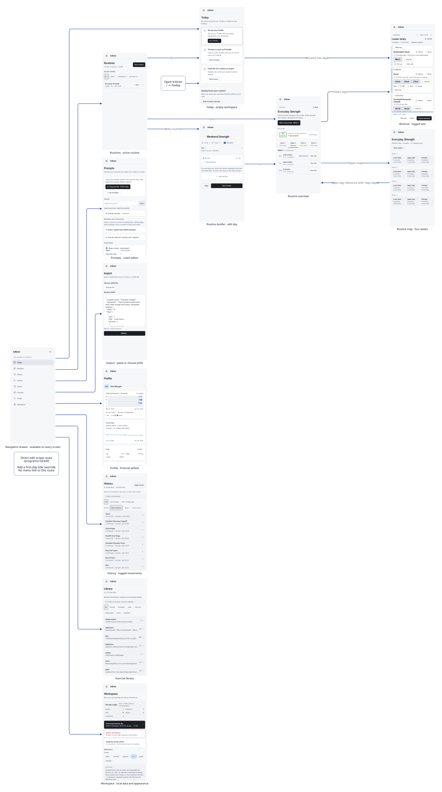
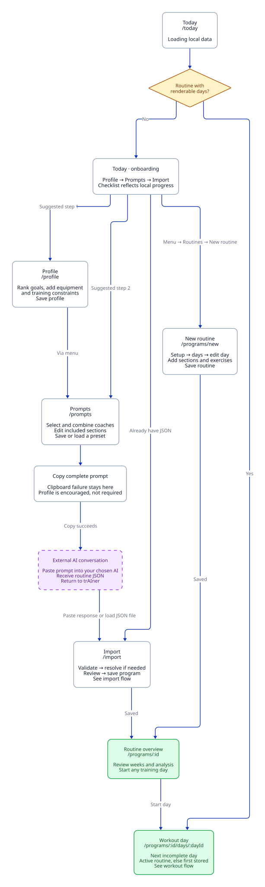
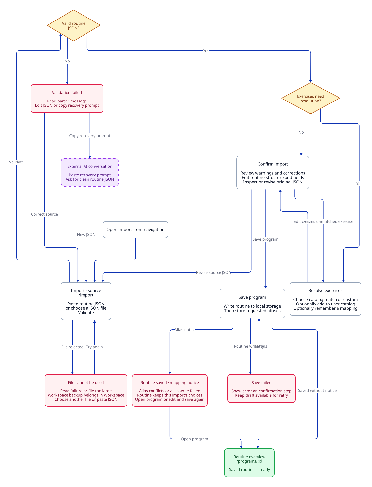
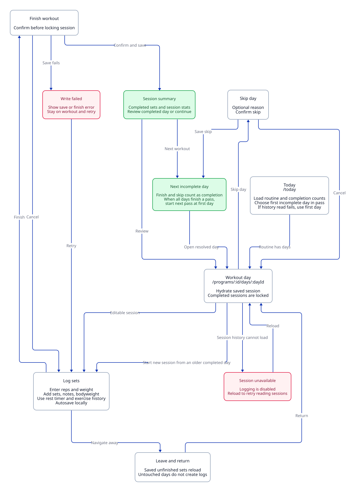
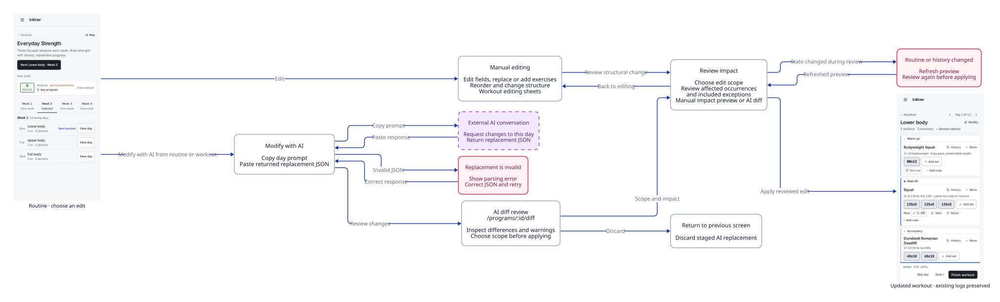
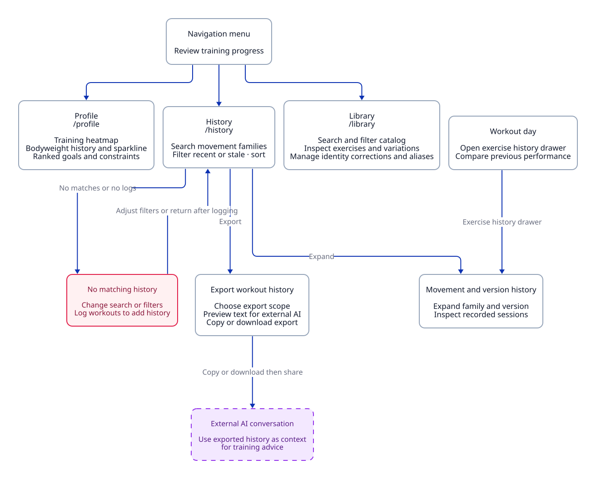
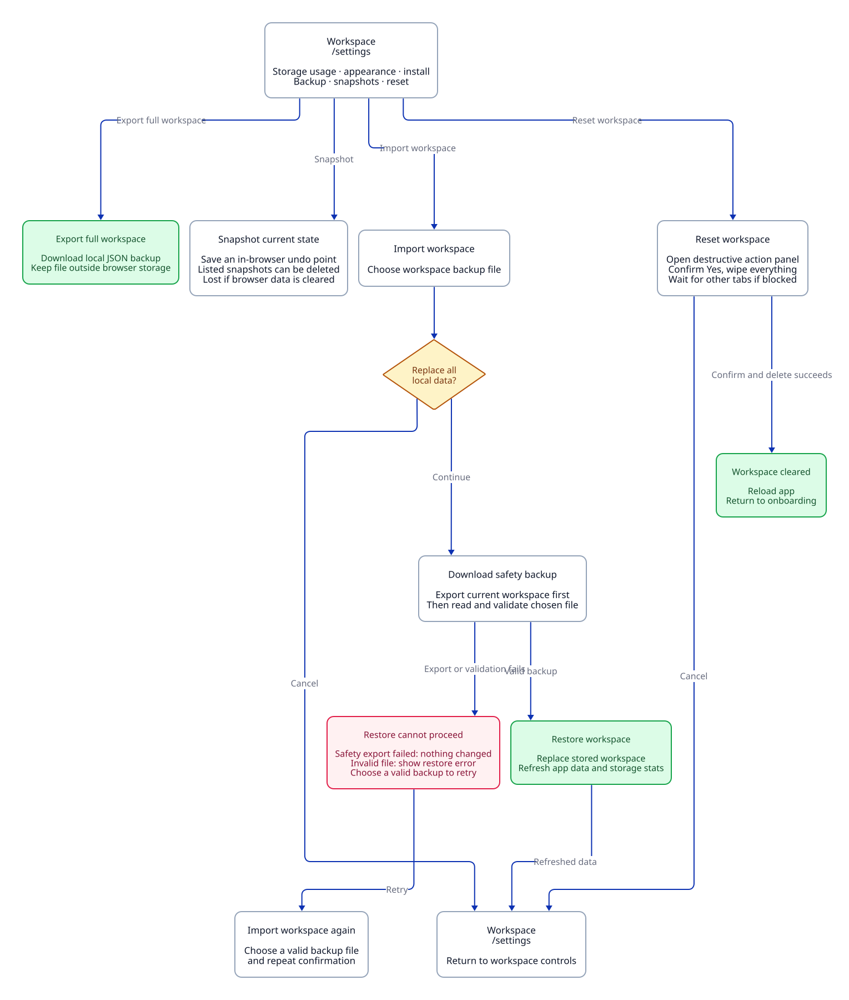

# User flows

These maps describe the implemented trAIner user journeys as of 2026-10-26. Cards represent screens or screen states, diamonds represent decisions, purple cards represent external AI chats, pink cards represent recovery states, and green cards represent saved outcomes. They are schematic flowcharts, not screenshots or proposed UI.

Open a preview below. Click an image to open the full SVG, then use your browser's zoom controls. GitHub renders these images directly. Viewing requires no app server, diagram editor, or installed dependencies.

| Map | Preview | Editable source |
| --- | --- | --- |
| Navigation and screens | [SVG](rendered/overview.svg) | [D2](overview.d2) |
| First routine, with AI or by hand | [SVG](rendered/getting-started.svg) | [D2](getting-started.d2) |
| Import and recovery | [SVG](rendered/import.svg) | [D2](import.d2) |
| Log, resume, finish, or skip a workout | [SVG](rendered/workout.svg) | [D2](workout.d2) |
| Manual and AI-assisted editing | [SVG](rendered/editing.svg) | [D2](editing.d2) |
| History, profile, and library | [SVG](rendered/progress.svg) | [D2](progress.d2) |
| Backup, restore, and reset | [SVG](rendered/workspace.svg) | [D2](workspace.d2) |

## Navigation and screens

All route labels omit the `/trAIner` browser-router base. The navigation menu is available throughout the app. A transition labeled "via menu" means that the user opens that menu, rather than following a screen-specific button.

[](rendered/overview.svg)

## First routine

The onboarding checklist suggests Profile, Prompts, and Import. Users can skip those suggestions and create a routine by hand. All AI conversations happen outside trAIner through copy and paste.

[](rendered/getting-started.svg)

## Import and recovery

Routine JSON files and workspace backup files have different import paths. Exercise matching can require user decisions before confirmation. An alias conflict does not undo the saved routine.

[](rendered/import.svg)

## Workouts

Today chooses the first incomplete day in the current pass through the routine. This follows completion counts rather than a calendar schedule. A skipped day counts as completed for this selection.

[](rendered/workout.svg)

## Editing

Manual structural edits use an impact preview. AI replacements use a diff review. The direct `/programs/:id/edit` route is a separate, minimal override screen, not the workout editor.

[](rendered/editing.svg)

## Progress

History groups movements and versions. History exports are text for an external AI conversation, not workspace backup files.

[](rendered/progress.svg)

## Workspace

Exported files protect against browser data loss. Snapshots remain in the same browser storage. The current snapshot list supports deletion, not a snapshot restore action.

[](rendered/workspace.svg)

## Source references

| Behavior | Implementation |
| --- | --- |
| Routes and global navigation | [App](../../src/App.tsx), [AppShell](../../src/components/app/AppShell.tsx) |
| Startup data loading and failure | [LocalDataProvider](../../src/components/app/LocalDataProvider.tsx) |
| Onboarding and next-day selection | [TodayClient](../../src/components/workout/TodayClient.tsx), [dayResolver](../../src/lib/workout/dayResolver.ts) |
| Profile and prompt generation | [ProfileClient](../../src/components/profile/ProfileClient.tsx), [PromptBuilderClient](../../src/components/prompts/PromptBuilderClient.tsx) |
| Import, matching, and confirmation | [ImportClient](../../src/components/import/ImportClient.tsx), [ResolutionStep](../../src/components/import/ResolutionStep.tsx) |
| Routine management and builder | [RoutinesIndexClient](../../src/components/workout/RoutinesIndexClient.tsx), [RoutineBuilderClient](../../src/components/workout/RoutineBuilderClient.tsx) |
| Overview, map, and direct edit route | [ProgramDetailClient](../../src/components/workout/ProgramDetailClient.tsx), [ProgramMapClient](../../src/components/workout/ProgramMapClient.tsx), [EditClient](../../src/components/workout/EditClient.tsx) |
| Logging, resume, finish, and skip | [WorkoutDayClient](../../src/components/workout/WorkoutDayClient.tsx), [SessionSummary](../../src/components/workout/SessionSummary.tsx) |
| AI edits and diff review | [ModifyAiModal](../../src/components/workout/ModifyAiModal.tsx), [DiffPage](../../src/components/workout/DiffPage.tsx) |
| History and export | [HistoryClient](../../src/components/workout/HistoryClient.tsx), [HistoryDrawer](../../src/components/workout/HistoryDrawer.tsx), [HistoryExportPanel](../../src/components/workout/HistoryExportPanel.tsx) |
| Exercise library | [LibraryClient](../../src/components/catalog/LibraryClient.tsx) |
| Workspace and backup | [SettingsClient](../../src/components/app/SettingsClient.tsx), [backup](../../src/lib/backup/backup.ts) |

## Update a flow

The `.d2` files are the source of truth. SVGs are generated output. Each journey owns its cards and transitions. Shared colors live in [style.d2](style.d2). D2 calculates layout, so agents do not maintain coordinates or viewer code.

1. Change the relevant journey file when its screens, decisions, or transitions change. Check the implementation links above.
2. Install [D2 v0.9.0](https://github.com/d2lang/d2/releases/tag/v0.9.0), which includes the ELK layout engine. D2 is only needed to edit diagrams.
3. Run `bun run docs:flows` from the repo root. To use a binary outside your PATH, set `D2_BINARY=/absolute/path/to/d2`.
4. Open the changed SVGs and check their labels and arrows. Commit the D2 source and generated SVGs together.

To preview one journey while editing:

```bash
d2 --watch --layout=elk docs/user-flows/import.d2 /tmp/trainer-import-flow.svg
```

These are maintained product maps, not automatically discovered routes. They cover the principal user journeys and recovery branches, not every input, modal, or storage failure. A startup data-load failure blocks the app with an error message before these journeys begin.
